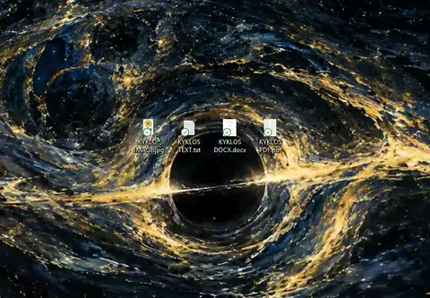

# Kyklos for Windows

Kyklos for Windows

Grab a file, get a radial wheel of formats right under the cursor, pick one, done.
Conversions happen in place; there is no import step, no project file, no window to clean up
afterwards.

It is a native Windows app: C# / .NET 9, WinForms, a real tray application — no Electron and
no runtime to install.

---

## What it does

Trigger the wheel over any file — from Explorer, from a drop target, or from the clipboard —
and the ring of formats appears under the cursor. Hover a format to see what it produces and
how big it will be; click to convert. Unavailable formats are greyed out with a reason rather
than failing after the fact.

Three ways to get the wheel:

| Trigger | How | Notes |
| --- | --- | --- |
| **Drag trigger** | Hold `Ctrl+Alt` and start dragging a file in Explorer | An invisible full-screen drop surface arms itself; drag over it and the wheel opens |
| **Global hotkey** | `Ctrl+Alt+C` | Converts whatever is selected in Explorer, or the files on the clipboard |
| **Drop target** | The floating Kyklos disc (bottom-right by default) | Drag files onto it, or click it to use the current Explorer selection |

The drag trigger is configurable (`Ctrl+Shift`, `Alt+Shift`, `Shift`, `Alt`) because plain
*Shift*+drag in Explorer means "move". The hotkey is configurable too, and both live in
**Settings**. A single balloon on the very first launch explains all of this, and never shows
again.

## Demo

Twelve seconds of the whole idea: the drag trigger opens the wheel mid-drag, a wedge converts
the file in place, and it repeats for a document source.

GitHub READMEs only autoplay video uploaded through GitHub itself, so the inline loop below is a
compressed WebP render. The full-quality recording is [`docs/showcase.mp4`](docs/showcase.mp4).



## Download

No SDK needed to use Kyklos. Grab the zip from the
[latest release](https://github.com/shrine2/Kyklos/releases/latest), unpack it anywhere, and
double-click **Install.cmd**. That copies the exe to the per-user install folder, sets up
starting at login and the **Send to** entry, and starts the tray — no admin rights.

Because it carries no code-signing certificate, first run may be greeted by
*Windows protected your PC* — choose **More info → Run anyway**.

The exe is self-contained and converts images and PDFs on its own. Everything else is priced
in honestly until its tool is installed: video and audio formats appear with
`winget install Gyan.FFmpeg`, Office documents with
`winget install TheDocumentFoundation.LibreOffice`. `Install.ps1` in the zip reports exactly
which of these apply at the end of an install.

## While it converts

The wheel is the progress display. Once you commit a format, the hub turns into a rotating
spinner, the line under the wheel counts the batch (`Converting 3 / 12`) and names the file
being worked on, and the wedges stop responding. When the batch finishes the wheel fades out
and disappears — a second conversion started straight afterwards never stacks a window on top
of the first, because no window is ever opened.

Cancelling:

- an **interactive** wheel (hotkey, drop target, tray menu) takes a click on the hub, or `Esc`;
- a **drag-driven** wheel stays click-through on purpose, so a long job cannot swallow clicks
  on whatever is underneath — cancel those with `Esc`.

If something fails, a tray balloon says how many; the per-file error text goes to
`%APPDATA%\Kyklos\conversions.log`.

## Formats

**Images** input: jpg, jpeg, jfif, png, webp, heic/heif, tif/tiff, bmp, gif, avif, ico, jxl,
tga, dds, psd, exr, hdr.
Output: **PNG, JPG, WebP, AVIF, TIFF, BMP, GIF, HEIC\*, PDF**.

**Video** input: mp4, m4v, mov, mkv, webm, avi, wmv, asf, mpg/mpeg, flv, ts, mts, m2ts, vob,
ogv, 3gp, divx, rm, rmvb.
Output: **MP4, MKV, MOV, WebM, AVI, WMV, GIF** — plus audio extraction to **MP3, M4A, WAV, FLAC**.

**Audio** input: mp3, m4a, m4b, wav, flac, ogg, oga, opus, aiff, aif, wma, aac, alac, ape,
mka, ac3, dts, amr, mp2, wv.
Output: **MP3, M4A, WAV, FLAC, OGG, OPUS, AIFF, WMA**.

**PDF** input: any `.pdf`.
Output: **PNG, JPG** (300 DPI page images), **TXT** (extracted text).

**Documents** input: docx, doc, docm, odt, rtf, txt, md, html, htm, epub, pptx, ppt, odp,
xlsx, xls, ods, xml, json, log, pages, numbers, key, wpd, wps.
Output: **PDF, TXT, DOCX, ODT, EPUB, HTML, RTF** — *requires LibreOffice (see below)*.

**Subtitles** input: srt, vtt. Output: **TXT, SRT, VTT**.

**Tables** input: csv, tsv. Output: **CSV, TSV**.

Subtitles and tables are done inside the app, so they still work when ffmpeg and LibreOffice
are both missing.

\* HEIC goes through the Windows Imaging Component (WIC), reached via WinRT — ffmpeg's build
has no libheif. Output needs the Microsoft Store **HEIF Image Extensions** package; without it
the HEIC wedge is greyed out and says why, and other formats stay unaffected. WIC is also what
decodes a HEIC **input**. The check is a real one-pixel encode, so it reflects the machine
rather than the presence of a package. Note that GDI+ (`System.Drawing`) cannot see WIC codecs
at all — asking it about HEIC reports "no codec" even when the codec is installed and working —
so this path deliberately avoids it.

Every target is checked against a live capability probe of the local `ffmpeg` at startup, so
the wheel only ever shows things this machine can actually produce. A file's own format is
never offered as a target, so the ring always means something.

### Tools behind the wheel

| Job | Kyklos drives |
| --- | --- |
| Audio / video | `ffmpeg` |
| Images | `ffmpeg`, with Windows WIC for HEIC/AVIF/JXL |
| Images → PDF | hand-rolled JPEG/DCTDecode PDF writer |
| PDF → images | WinRT `Windows.Data.Pdf` |
| PDF → text | PdfPig |
| Office / EPUB | headless LibreOffice (`soffice`) |

## Requirements

- Windows 10 2004 (build 19041) or newer, x64.
- **ffmpeg** on `PATH` or pointed at from Settings. The
  [Gyan full build](https://www.gyan.dev/ffmpeg/builds/) is what this was developed against:
  `winget install --id Gyan.FFmpeg -e`.
- **LibreOffice** — optional, and only needed for document conversions:
  `winget install --id TheDocumentFoundation.LibreOffice -e`. Without it those targets appear
  greyed out marked "needs LibreOffice".
- A checkout builds with the **.NET 9 SDK**; the published single-file build needs nothing
  installed at all.

## Build and run

```powershell
# develop
dotnet build "src\Kyklos\Kyklos.csproj"
& "src\Kyklos\bin\Debug\net9.0-windows10.0.19041.0\Kyklos.exe"
```

Or take the whole step at once with `publish.ps1` — closing the running tray, publishing the
compressed build, refreshing the login entry and the **Send To** shortcut against the fresh exe,
and starting it again:

```powershell
.\publish.ps1        # -NoStart to publish without starting the tray
```

The manual equivalent of that one command is:

```powershell
# one self-contained exe (~54 MB, no runtime required)
dotnet publish "src\Kyklos\Kyklos.csproj" -c Release -r win-x64 `
  --self-contained true -p:PublishSingleFile=true `
  -p:IncludeNativeLibrariesForSelfExtract=true `
  -p:EnableCompressionInSingleFile=true `
  -o "$env:LOCALAPPDATA\Programs\Kyklos"
```

That folder is the install location, so publishing there keeps everything pointing at the same
file: the login entry and the **Send to** shortcut both resolve to whichever `Kyklos.exe` is
running, rather than to a path someone typed once. Close Kyklos first — Windows will not replace
a running executable. For the same reason nothing is published inside the repository any more;
a build output that autostart depends on means a move, a re-clone or a `git clean -xdf` quietly
breaks starting at login.

Leave `-p:EnableCompressionInSingleFile=true` **on**: it is what keeps the exe near 54 MB rather
than 129 MB, and it is *not* what Windows objects to. A **newly written unsigned exe can be
refused on first sight**, whatever its size and whether or not it is compressed:

```
An Application Control policy has blocked this file.
```

The refusal comes from the shell that tried to start it, `Microsoft-Windows-CodeIntegrity`
records event 3033 and 3077 naming the exe, and the file is fine — running it again a moment
later works, and nothing needs rebuilding. It is intermittent, but it is worth expecting on the
first launch after a publish, and worth passing on to anyone the exe is handed to. Check the
policy with:

```powershell
(Get-ItemProperty "HKLM:\SYSTEM\CurrentControlSet\Control\CI\Policy").VerifiedAndReputablePolicyState
# 0 = off, 1 = enforcing, 2 = evaluating
```

An earlier round of testing concluded that compression itself was the trigger, because the
compressed build was refused and the uncompressed one ran. Both were freshly published; the
refusal was the first-sight behaviour above and the difference in outcome was timing. Measured
again with the same source, a compressed build starts on the first attempt with no code
integrity event at all. Smart App Control cannot be turned back on once it is switched off, so
there is nothing to weigh against leaving it enabled.

The app is single-instance. Anything launched a second time — including the **Send to →
Convert with Kyklos** shortcut, which Settings can install for you — hands its file list to
the running tray over `WM_COPYDATA` and exits.

## Icon

The mark is the app reduced to one glyph: a dark disc carrying the wheel, an accent ring around
it, and a glowing hub at the centre — the bright core and radial lanes of a telescope plate,
flattened into the app's own palette. It is drawn in code (`Ui\Branding.cs`) and written out on
demand, so it stays reproducible from source instead of being a binary of unknown origin:

```powershell
Kyklos.exe --writeicon "src\Kyklos\Resources\Kyklos.ico"
```

That writes the committed `.ico` plus a `-256.png` preview beside it for looking at without
opening Explorer. Every size — 16, 20, 24, 32, 40, 48, 64, 128, 256 — is drawn at its own size
rather than scaled down, because a 256-pixel mark scaled to 16 loses its ring. The frames are
plain 32-bit bitmaps rather than PNGs; a PNG frame would be smaller, but GDI+ and a good deal of
other software cannot parse one at all. Exit code `97` if it fails, `98` if no path was given.
The file properties dialog and the taskbar are fed by `Product`/`Version`/`AssemblyTitle` in
`Kyklos.csproj`, alongside `<ApplicationIcon>`.

The tray and floating icons stay a plain ring rather than this mark, which survives a busy
taskbar and any wallpaper better than a dark disc would.

## Settings

Stored as JSON at `%APPDATA%\Kyklos\settings.json`; a crash log and the conversion failure log
land beside it. A fault raised inside a user-interface event goes to that crash log as well —
Kyklos says so and carries on rather than disappearing.

- **Output** — write beside the original, or into a subfolder (default `converted`).
- **If the name exists** — rename (default), overwrite, or skip.
- **Quality** — fast / balanced / best; feeds CRF, encoder preset and image quality.
- **Strip metadata** — drop EXIF/GPS and container tags on the way out.
- **Start with Windows**, plus the Send To shortcut and the drag-surface toggle.
- **Per-file overrides** from the wheel's tool ring: compress, trim/resize, extract audio,
  make GIF, to PDF.

Overwriting in place is handled by staging the output to a temporary path first and then
swapping it in, because some encoders (notably `ffmpeg`) refuse to write to their own input.

## Self-test

The binary carries an end-to-end harness that generates its own fixtures and converts them
through the real pipeline:

```powershell
Kyklos.exe --selftest "C:\temp\kyklos-selftest" all
Kyklos.exe --selftest "C:\temp\kyklos-selftest" video    # images|video|audio|pdf|text|docs|all
```

Quote any path containing spaces. It writes `selftest-report.txt` into the target folder and
sets its exit code to the number of failed checks.

Two more switches exist for checking the GUI itself:

```powershell
Kyklos.exe --smoketest "C:\temp\sample.png"
Kyklos.exe --uipreview "C:\temp\sample.png"
```

`--writeicon` (see [Icon](#icon)) renders the app mark. None of these switches write settings:
a diagnostic run has no business rewriting your configuration, and a test that clicks through
the switches does click real ones.

`--smoketest` boots the real tray, runs one genuine conversion through the very code path the
wheel uses, then walks the floating drop target through show/hide/show and clicks **Hide this
icon** in its own context menu, and finally exits the way **Exit** does. Every failure mode has
its own exit code, because a smoke test that can pass without testing anything is worse than no
test at all: `1` the drop target did not settle, `2` the conversion failed, `3` a UI-thread
exception was logged, `4` hiding the icon failed, `5` a phase threw. `--uipreview` opens the
wheel and drives it through a simulated batch so the spinner, the caption and the fade-out can
be looked at without converting anything; it is the quickest way to eyeball a layout change.

Both switches run ahead of the single-instance check, so they are safe to use while the tray is
up, and neither can block on a dialog — which makes them safe to run unattended.

## Project layout

```
src/Kyklos
  Program.cs              entry point, single-instance mutex, IPC hand-off, CLI switches
  TrayApp.cs              orchestrator: tray icon, hotkey, drag surface, wheel, conversions
  Core/
    Converter.cs          dispatch, in-place staging, batch runs
    FormatCatalog.cs      target tables, availability against the live probe
    Toolchain.cs          ffmpeg / soffice discovery and capability probe
    PdfTools.cs  WicImage.cs  OfficeTools.cs
    TextTools.cs          subtitle (SRT/VTT) and delimited (CSV/TSV) conversions
    Settings.cs  Paths.cs  SelfTest.cs
  Interop/
    NativeMethods.cs      Win32, incl. the teardown fix described below
    ModifierWatcher.cs    arms the drop surface on modifiers + pointer-down over the shell
    HotkeyWindow.cs  Hotkeys.cs  IpcWindow.cs  ClipboardFiles.cs
  Ui/
    RadialMenuForm.cs     the wheel; also draws the hub spinner and the fade-out
    DropSurfaceForm.cs  DropTargetForm.cs
    SettingsForm.cs  AdvancedDialog.cs  Theme.cs  Dark.cs
```

### Two notes worth keeping

**Why not intercept Shift+drag?** Explorer owns its OLE drag loop, and a modifier change
mid-drag can't be injected into it. Instead the app watches for the configured modifiers plus
a pointer-down over an Explorer surface and raises its own invisible full-screen drop surface
on top, so the drop lands on us. That's also why the default is `Ctrl+Alt` rather than `Shift`.

**Why `TerminateProcess` instead of a normal shutdown?** On AMD hardware a mix of WinRT, WIC
and GDI+ work makes `atidxx64.dll` fault during DLL detach, turning a clean exit into an access
violation *after* all output is written and all checks pass. `NativeMethods.HardExit` flushes
and then ends the process without running driver detach, which is safe here because everything
is already on disk. It is the difference between the self-test reporting `ALL CHECKS PASSED`
and the same run reporting an `0xC0000005`.

## The wheel by design

- The first format sits centred on 12 o'clock and the ring runs clockwise: JPG, PNG, WebP,
  HEIC, TIFF, AVIF, BMP, then PDF.
- A file's own format never appears on its own ring, so the choices always mean something.
- The hub carries the size of the selection as a small pill (`2.2 MB`).
- Tool wedges are uppercase words only: COMPRESS, RESIZE, NO META, PDF. A tool that is
  switched on is tinted rather than marked with a symbol.

## Known limits

- **No file-actions wheel.** Copy, move and share are Explorer's job; the Send To menu covers
  the same ground, and there is no Windows answer to peer-to-peer airdrops.
- **Tools share the wheel** with formats instead of living on a separate options ring.
- **No Apple office formats.** Pages, Numbers and Key documents, and PDF→PAGES/PPTX/XLSX, have
  no Windows converter.
- **No image → DOCX.** LibreOffice refuses `--convert-to docx` for a picture ("no export
  filter", it opens images in Draw), so it would need a hand-written OOXML writer.
- **No archives** by choice — ZIP/TAR/GZIP are absent rather than half-done.

Targets that are easy to miss: MP4→M4A/WAV/FLAC audio extraction, and WebP/AVIF/TIFF/BMP→GIF.

---

## License

MIT — use it, learn from it, change it, ship it in your own repo; the only obligation is the
copyright notice. See [LICENSE](LICENSE).
